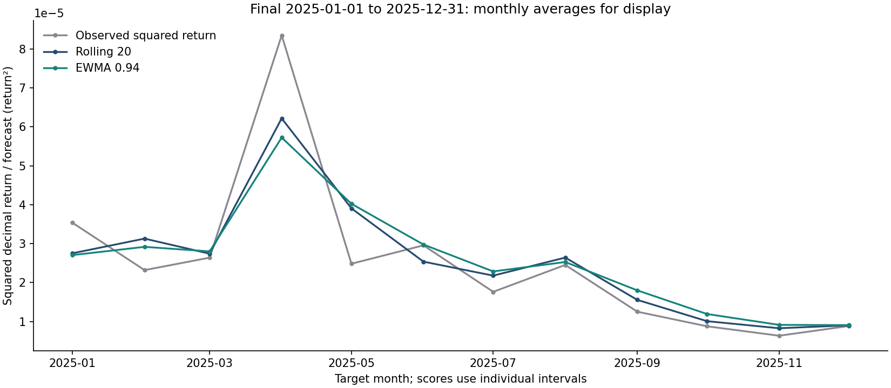

# FX Volatility Research

A reproducible comparison of rolling and exponentially weighted EUR/USD
squared-return forecasts, using ECB reference rates from 2010–2025.

**Research question:** does EWMA with fixed decay 0.94 have lower forecast
MSE than the average of the previous 20 squared returns?

**Result:** EWMA recorded **3.56% lower MSE across 255 final-period targets
in 2025**. This is a descriptive forecasting comparison; it does not
establish statistical significance or trading profitability.

Source: **ECB statistics**. Original responses, retrieval metadata and
derived outputs are included. See [data sources and reuse](DATA_SOURCES.md).

## Results

| Target period | Role | Targets | Rolling MSE | EWMA MSE | EWMA / rolling MSE − 1 |
| --- | --- | ---: | ---: | ---: | ---: |
| 2010–2021 | Development | 3,053 | 3.3333808e-09 | 3.2749149e-09 | −1.75% |
| 2022–2024 | Validation | 768 | 4.1842267e-09 | 4.1084613e-09 | −1.81% |
| 2025 | Final evaluation | 255 | 4.5071751e-09 | 4.3467104e-09 | −3.56% |

The dataset contains **4,097 quotes**, **4,096 interval returns**, and
**4,076 scored forecasts** after 20 warm-up returns. Both models use the
same eligible targets. MSE has fourth-power decimal-return units; the
[machine-readable summary](reports/research/final_summary.json) retains
full precision.

EWMA's advantage is not uniform: rolling has lower error in 2012 and 2017.
In 2025, the five-calendar-day subgroup also favors rolling, but contains
only two targets. Annual and gap diagnostics are descriptive.



Monthly averaging is for display only. Every score uses individual
published-observation intervals.

Read the [research report](reports/research_report.md) for methods,
diagnostics and limitations, and the [experiment record](EXPERIMENTS.md)
for the sequence of decisions.

## Reproduce

Use **Python 3.12**. A new installation needs internet access for packages;
the analysis itself can run entirely from the included snapshots.

PowerShell, from the repository root:

```powershell
python -m venv .venv
.\.venv\Scripts\python.exe -m pip install -r requirements-lock.txt
.\.venv\Scripts\python.exe -m unittest discover -s tests -v
.\.venv\Scripts\python.exe run_research.py --stage development --offline
.\.venv\Scripts\python.exe run_research.py --stage final --offline
```

On Linux/macOS, create the environment with `python3.12 -m venv .venv`
and use `.venv/bin/python` in place of `.\.venv\Scripts\python.exe`.

`requirements.txt` pins Matplotlib and its NumPy compatibility version;
`requirements-lock.txt` records the complete resolved runtime dependencies
tested for this release. The model calculations use Python's standard library.

`--offline` requires the raw CSV/metadata pairs already bundled in
`data/raw/`. The development stage reads 2010–2024; the final stage also
reads 2025 after checking the protocol. Reports and figures are regenerated;
raw responses and their original retrieval metadata are preserved.

The public package includes `.gitattributes`, which preserves the frozen
source/configuration line endings and original CSV/raw-response bytes.
Keep it in the repository alongside the snapshots and protocol lock.

### Worked examples

```powershell
.\.venv\Scripts\python.exe lessons/day10_rolling_exercise.py
.\.venv\Scripts\python.exe lessons/day11_ewma_exercise.py
.\.venv\Scripts\python.exe lessons/day12_mse_comparison.py
```

The first two reproduce a rolling forecast and an EWMA update. The third
illustrates MSE with two development targets, then separately checks all
255 final targets. The two-target example's percentage is not the 2025 score.

## Method and information timing

For quotes in USD per EUR:

```text
r[t] = (quote[t] - quote[t-1]) / quote[t-1]
target[t] = r[t] ** 2
rolling[t] = mean(r[t-20]**2, ..., r[t-1]**2)

# After saving forecast[t] and observing its target:
ewma[t+1] = 0.94 * ewma[t] + 0.06 * r[t]**2

loss[t] = (forecast[t] - target[t])**2
MSE = mean(loss)
```

EWMA is initialized from the first 20 earlier squared returns. Those
returns provide warm-up only. History and state carry across chronological
split boundaries; the window and decay remain fixed. There was no
hyperparameter search.

Targets are assigned by their ending observation date. The first 2025
target ends on 2 January and uses information through 31 December 2024.
Changing a future return cannot change a forecast issued before it is
observed; the tests check this property.

The [protocol record](reports/research/protocol_lock.json) was created
before the pipeline's first 2025 access on 23 October 2026. The final stage
checks frozen code/configuration and development-data fingerprints. This
is a local audit trail, not externally certified preregistration. The
2025 results are now known; a rerun is reproduction of that evaluation.

## Essential code and supporting files

Every application, test and worked-example Python file is listed below.
[CODE_GUIDE.md](CODE_GUIDE.md) explains their inputs, outputs, main
functions and suggested reading order in more detail.

| File | Purpose |
| --- | --- |
| [fx_calculator.py](fx_calculator.py) | Reusable simple-return formula and artificial EUR/SEK payment examples; imported by the research models. |
| [research_data.py](research_data.py) | Validate ECB responses, preserve snapshots, verify hashes and audit publication dates. |
| [forecast_models.py](forecast_models.py) | Construct interval returns, form rolling/EWMA forecasts and summarize MSE. |
| [run_research.py](run_research.py) | Run chronological stages, enforce the protocol and save forecasts, scores and figures. |
| [download_fx_data.py](download_fx_data.py) | Download/cache the separate January 2024 teaching snapshot and create its working CSV. |
| [audit_fx_data.py](audit_fx_data.py) | Audit the January teaching dataset and its publication calendar. |
| [analyze_fx_data.py](analyze_fx_data.py) | Generate the teaching sample's returns, descriptive statistics and chart. |
| [tests/test_research_data.py](tests/test_research_data.py) | Check parsing, metadata/cache integrity, holiday handling and calendars. |
| [tests/test_forecast_models.py](tests/test_forecast_models.py) | Check arithmetic, initialization, timing, future-data perturbations and invalid inputs. |
| [tests/test_research_pipeline.py](tests/test_research_pipeline.py) | Check split boundaries, protocol gates and offline behavior. |
| [tests/test_learning_examples.py](tests/test_learning_examples.py) | Check worked-example EWMA and scoring calculations and edge cases. |
| [lessons/day10_rolling_exercise.py](lessons/day10_rolling_exercise.py) | Reproduce one forecast from 20 supplied earlier returns. |
| [lessons/day11_ewma_exercise.py](lessons/day11_ewma_exercise.py) | Reproduce the next EWMA update from a supplied estimate and observed return. |
| [lessons/day12_mse_comparison.py](lessons/day12_mse_comparison.py) | Show paired losses and independently recalculate the final-period score. |
| [study_config.json](study_config.json) | Fixed date boundaries, window, decay, target and assumptions. |
| [requirements.txt](requirements.txt) / [requirements-lock.txt](requirements-lock.txt) | Compatible top-level requirements and the tested resolved versions. |
| [.gitattributes](.gitattributes) / [.gitignore](.gitignore) | Preserve relevant bytes and exclude environments, caches and personal preparation notes. |
| [.github/workflows/ci.yml](.github/workflows/ci.yml) | Configure tests and offline reproduction on Windows and Ubuntu after upload. |

The worked examples' adjacent JSON fixtures contain their inputs and
provenance. `data/raw/` contains source responses and metadata;
`data/processed/` contains derived quotes and the teaching returns.
`reports/research/` contains forecast CSVs, summaries, the protocol and plots.

Local verification is recorded in [the validation report](reports/validation_report.md).
The workflow configuration is included; its GitHub execution status becomes
available after the repository is uploaded.

## Limitations

- Under a zero conditional mean assumption, expected squared return equals
  conditional variance. Individual squared returns remain noisy proxies.
- The horizon is the next published observation interval. Weekend and
  closure gaps are retained; the returns are not scaled to a constant
  24-hour horizon or annualized.
- ECB reference rates are informational observations, not executable prices
  or market closes. There is no trading simulation or transaction-cost model.
- Snapshots retrieved later do not reconstruct historical data vintages.
- One currency pair and one final year provide limited evidence about
  generalization. MSE is sensitive to large movements; no formal
  significance test or confidence interval is implemented.

## Assistance and source acknowledgement

This is a guided, AI-assisted learning project. AI contributed to the
implementation, tests, explanations and report drafting. The reported
numbers are reproducible artifact results; independent implementation or
model novelty is not claimed.

Source: **ECB statistics**. Raw source responses are retained, while
processed observations, returns, forecasts, scores and figures are
project-derived outputs. Source links and reuse conditions are documented
in [DATA_SOURCES.md](DATA_SOURCES.md).
