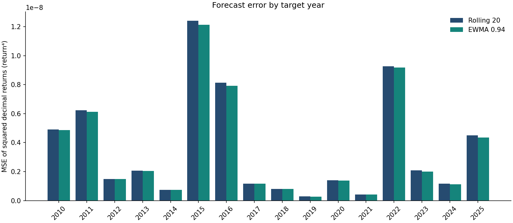
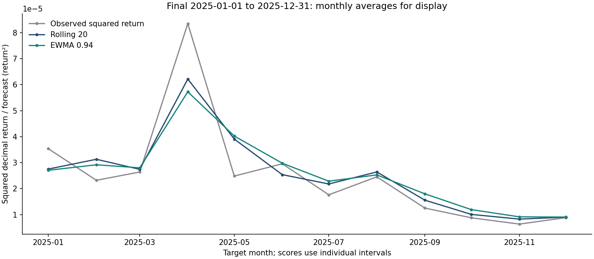

**Forecasting EUR/USD squared returns: a fixed rolling–EWMA comparison**

Computational study completed in October 2026; public packaging checked on
3 November 2026. The study choices and first final-period evaluation remain
those recorded on 23 October.

This study compares a rolling 20-observation mean of squared returns with an exponentially weighted moving average (EWMA), using ECB EUR/USD reference quotes from 2010 through 2025. On the reserved 2025 period, EWMA produced mean squared error (MSE) of **4.34671043 × 10⁻⁹**, against **4.50717506 × 10⁻⁹** for rolling: a **3.56% reduction** on the same 255 forecast intervals. The result supports a narrow descriptive conclusion about these forecasts and this sample. It does not establish statistical significance, general superiority, or trading profitability. Exact results and individual forecast records are available in the [saved summary](research/final_summary.json) and [forecast CSV](research/final_forecasts.csv).

The source is ECB series `EXR.D.USD.EUR.SP00.A`: daily reference quotes in US dollars per euro, with unit multiplier zero. The retained originals comprise 3,842 numeric quotes for 2010–2024 and 255 for 2025, giving 4,097 quotes from 4 January 2010 to 31 December 2025. Each response has its request URL, retrieval timestamp, original-byte SHA-256 hash, and metadata. Positive finite values, exact series dimensions, canonical dates, uniqueness, ordering, requested bounds, and calendar completeness were checked. These are snapshots retrieved on 23 October 2026, rather than historical data vintages showing exactly what was available on every past forecast date. The [ECB reference-rate page](https://www.ecb.europa.eu/stats/policy_and_exchange_rates/euro_reference_exchange_rates/html/index.en.html) describes the source and its information purpose.

The expected calendar excludes weekends, 1 January, Good Friday, Easter Monday, 1 May, and 25–26 December. The same TARGET closure rule appears in the ECB’s [2009 user guide, section 2.3](https://www.ecb.europa.eu/pub/pdf/other/target2progressreport5-a1-informationguidetarget2usersen.pdf), [2018 guide, section 2.6](https://www.ecb.europa.eu/paym/target/target2/profuse/nov_2018/shared/pdf/Information_Guide_fo_TARGET2_users_v12.0.pdf), and [2025 guide, section 2.6](https://www.ecb.europa.eu/paym/target/consolidation/profuse/shared/pdf/Infoguide-R2025.JUN-Part-1-Fundamentals.pdf). All 4,097 expected publication dates were present, with no missing or unexpected numeric observations.

An actual source-format failure required repair before the protocol was locked. The initial parser rejected an empty rate on 1 January 2010. Inspection found nine blank rows marked `OBS_STATUS=H`, all on calendar holidays in 2010–2012, within 3,851 raw development/validation rows. [SDMX’s observation-status code list, Appendix 15](https://sdmx.org/wp-content/uploads/SDMX_2_0_SECTION_04_SDMX-EDI.pdf) defines `H` as a holiday/weekend missing value. The repaired parser omits only an empty `H` row on a verified nonpublication date, while preserving raw bytes and recording skipped dates in metadata. It rejects unmarked blanks, blank rates carrying other missing-value flags, numeric `H` rows, and `H` on expected publication dates. Duplicate checks cover every raw date. No zero, interpolation, or forward fill was introduced.

Reference quotes are not executable transaction prices or market closes. Publication timing also changed within the sample: the ECB announced a shift from around 14:30 CET to around 16:00 CET from 1 July 2016, while retaining the rate-setting methodology. Forecast origins should therefore mean **after that date’s publication**, rather than a common market-close timestamp throughout the sample. This interpretation follows the [ECB’s 7 December 2015 announcement](https://www.ecb.europa.eu/press/pr/date/2015/html/pr151207.en.html).

For consecutive published quotes, the simple return is `r_t = P_t / P_(t−1) − 1`; the target is `y_t = r_t²`. A squared return is a noisy realized quantity. Its conditional expectation equals conditional variance plus the squared conditional mean. Calling these forecasts variance approximations therefore relies on the declared zero conditional mean assumption; the observed square itself is not an observed conditional variance. Forecasts and targets have units of return². Their squared-error loss, and hence MSE, has units of **return⁴**. Returns use decimals, so these small numerical MSEs are neither currency losses nor percentages.

At each origin, rolling uses the preceding 20 observed squared returns. EWMA uses decay 0.94, updating its saved forecast with weight 0.94 and the newly observed square with weight 0.06. The decay is a fixed illustrative choice. Both begin from the mean of the first 20 squared returns; these 20 intervals are warm-up and are excluded from scoring. Each forecast is emitted before its target is used in an update. The 4,096 consecutive-quote returns consequently produce 4,076 scored forecasts, beginning on 2 February 2010. Both methods use exactly the same eligible intervals.

Splits are assigned by target date: development through 2021, validation in 2022–2024, and final evaluation in 2025. Rolling history and EWMA state carry across boundaries, using only information available at each origin; neither is reset at a split. Window, decay, target, splits, and loss were fixed without a parameter search. Validation did not select a replacement specification. The [local protocol record](research/protocol_lock.json) froze code/configuration fingerprints at **2026-10-23 18:09:20 UTC**; final-snapshot metadata records retrieval at **18:09:57 UTC**. The pipeline required that lock before accessing 2025. This is a retrospective local audit trail, without external timestamp certification or external preregistration.

| Target period | Forecasts | Rolling MSE | EWMA MSE | EWMA relative change |
| --- | ---: | ---: | ---: | ---: |
| Development, 2010–2021 | 3,053 | 3.33338082 × 10⁻⁹ | 3.27491492 × 10⁻⁹ | −1.75% |
| Validation, 2022–2024 | 768 | 4.18422668 × 10⁻⁹ | 4.10846128 × 10⁻⁹ | −1.81% |
| Final, 2025 | 255 | 4.50717506 × 10⁻⁹ | 4.34671043 × 10⁻⁹ | −3.56% |

Relative change is `100 × (EWMA MSE / rolling MSE − 1)`, so negative values favor EWMA. The final reduction exceeds the development and validation reductions, but one reserved year provides limited evidence about stability. These are averages of interval losses, not averages of yearly percentage improvements.

Annual diagnostics show lower EWMA error in 14 of 16 target years. Rolling performed slightly better in 2012 and 2017, when EWMA’s relative changes were +0.18% and +0.75%. EWMA reductions were 1.09% in 2022, 3.76% in 2023, and 4.13% in 2024. Absolute errors varied substantially: 2015 had the highest annual rolling MSE, 1.24163142 × 10⁻⁸. A pooled advantage does not imply a uniform advantage across years.



The target is the next **published-observation interval**, with mixed calendar lengths. No daily scaling or annualization is applied. In 2025, 201 intervals spanned one calendar day, 50 spanned three days, two spanned two days, and two spanned five days. The gap diagnostics retain this distinction:

| Final-period calendar gap | Intervals | EWMA relative MSE change |
| --- | ---: | ---: |
| 1 day | 201 | −2.76% |
| 2 days | 2 | −62.76% |
| 3 days | 50 | −7.61% |
| 5 days | 2 | +73.51% |

The five-day result favors rolling, while the other groups favor EWMA. Groups containing two observations cannot support stable subgroup conclusions. Pooling gaps answers the declared next-publication forecasting question; it does not estimate a constant 24-hour horizon or show that calendar length is irrelevant.



Monthly averages in this second figure are **display only**. They summarize already issued forecasts and realized squared returns for readability. Every reported MSE uses individual eligible intervals; no monthly aggregation enters the score. Apparent monthly alignment should not be interpreted as additional predictive evidence.

The study demonstrates an auditable comparison, with modest lower EWMA loss under one fixed specification. It includes no formal significance test, confidence interval, executable-price simulation, transaction costs, or profit calculation. Extreme squared returns can strongly influence squared-error rankings, and the single final year leaves regime stability unresolved. Any extension should declare its new choices before further evaluation. AI assistance contributed to the implementation, tests and report drafting as part of a guided learning project. Independent implementation and model novelty are not claimed.


## Reproduction

The verified environment is Python 3.12.4 and Matplotlib 3.8.4. From the
project root, use the saved snapshots:

```powershell
python -m unittest discover -s tests -v
python run_research.py --stage development --offline
python run_research.py --stage final --offline
```

The 62 automated checks cover the research components and completed
learning examples. The [validation report](validation_report.md) records
reproduction and independent score checks. Exact values remain in the
[saved summary](research/final_summary.json). These reruns reproduce an
already evaluated experiment; they are not new independent assessments.
